# VidAnki

Watch B&B and Sketchy videos in dark mode, then do their high-yield Anki cards before the next video.

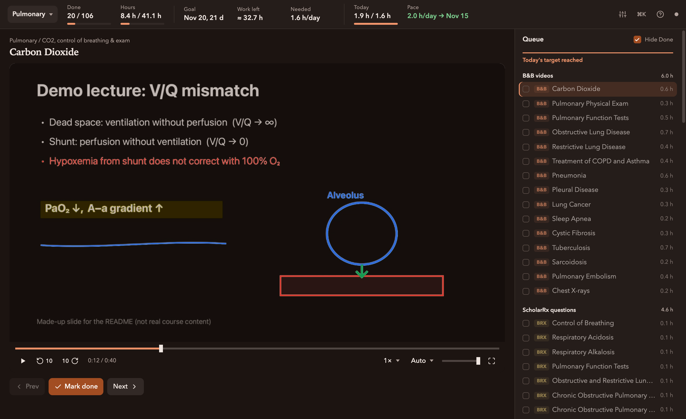

<sub>Screenshots use a made-up demo slide and sample progress, not real course videos.</sub>

## Features

**Smart dark mode for videos.** White slides turn near-black and black ink turns light, while colored ink keeps its color, like Dark Reader for video. Highlighter fills darken so the text on them stays readable. It follows your system theme, and you can switch to Invert, Dim or Original.

<table>
<tr><td>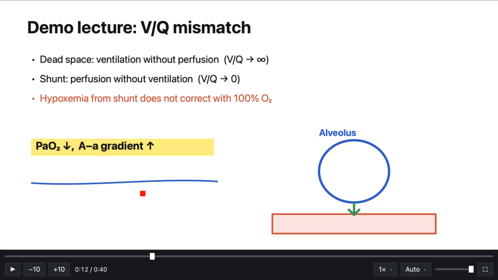</td><td>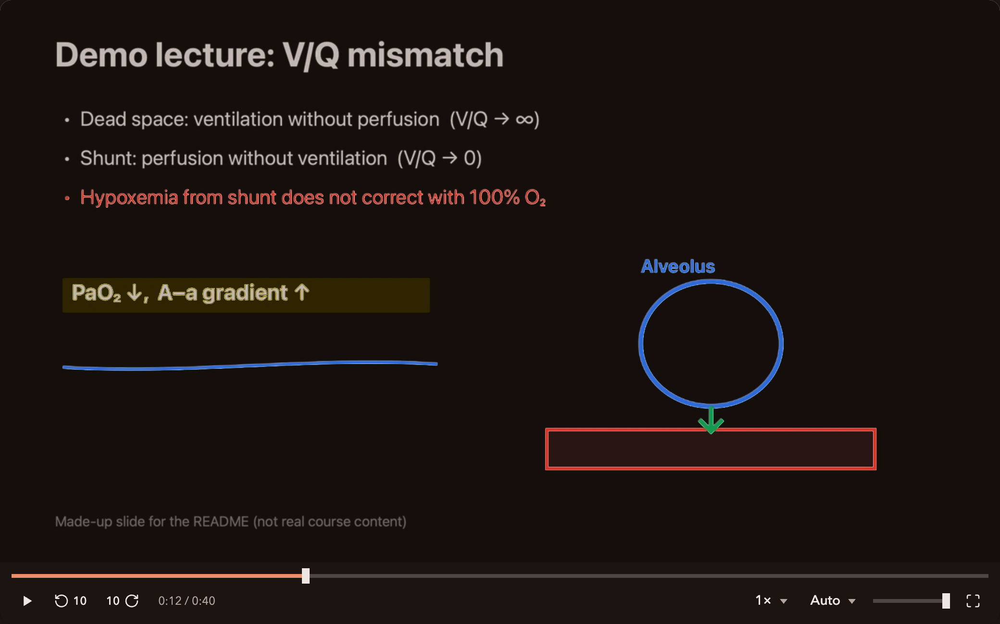</td></tr>
<tr><td align="center">Original</td><td align="center">Smart dark</td></tr>
</table>

**Video → Anki → next video.** Near the end of a video VidAnki offers to mark it done. That renames the file with a leading `_`, unsuspends its high-yield AnKing cards, and puts the new ones in a filtered deck. The next video waits until you've studied them; you can always skip.

<table>
<tr><td>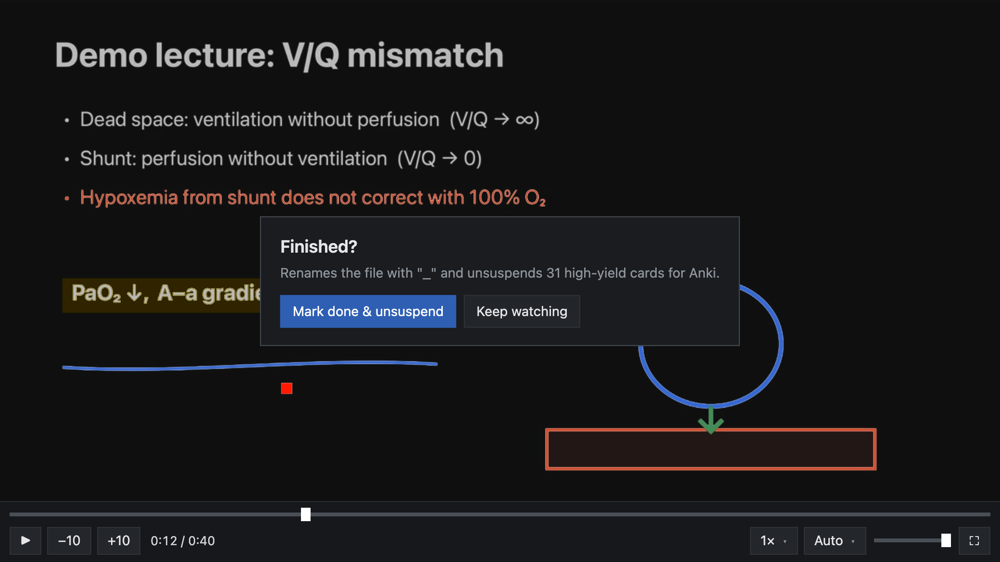</td><td>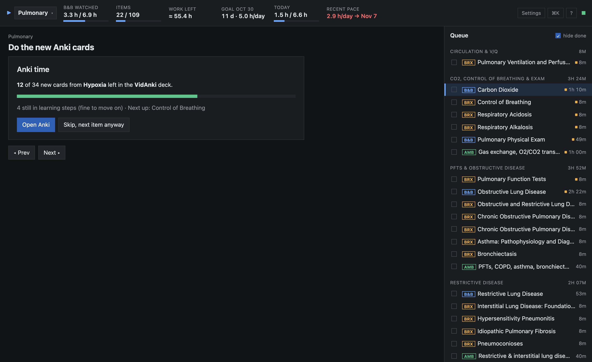</td></tr>
</table>

**One queue for everything.** Sketchy Micro and Pharm videos sit next to the B&B video that covers the same topic, followed by ScholarRx brick questions and AMBOSS question sets. Opening a brick starts its timer, and you can edit or reset any timer.

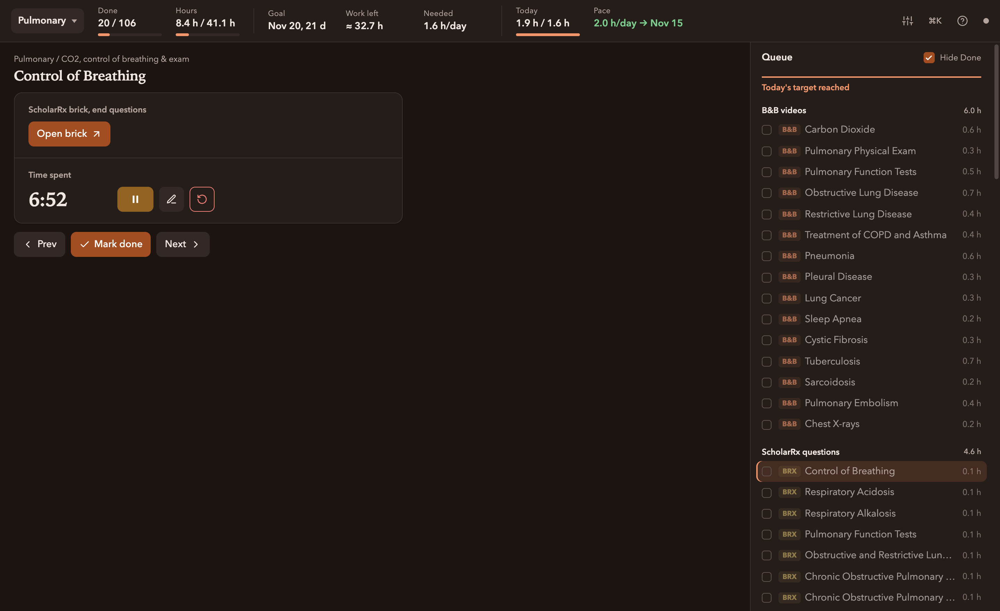

**Time estimates that learn.** VidAnki counts videos, new cards, the reviews they'll create, bricks and AMBOSS questions, and tells you the hours per day you need to hit your goal date. It starts from defaults and adjusts to how long you actually take. You can change the goal date, override any estimate, and choose which card tiers get unsuspended.

<table>
<tr><td width="34%">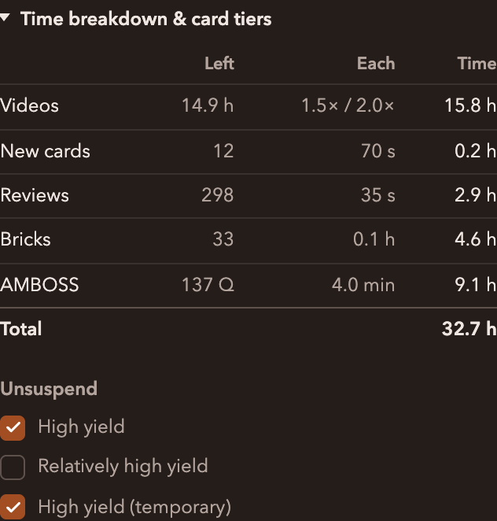</td><td>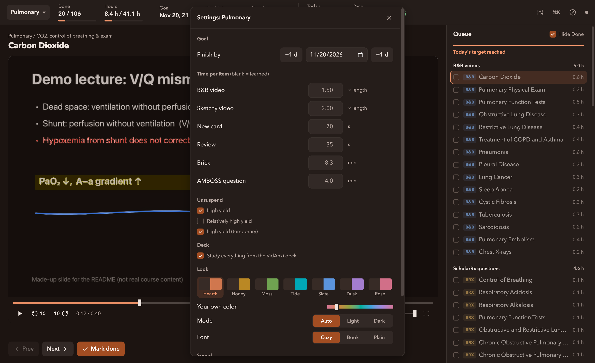</td></tr>
</table>

**Keyboard first.** ⌘K searches every command and jumps to any item; `?` lists the shortcuts.

<table>
<tr><td>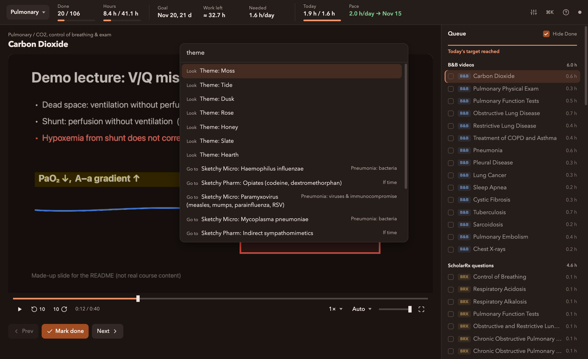</td><td>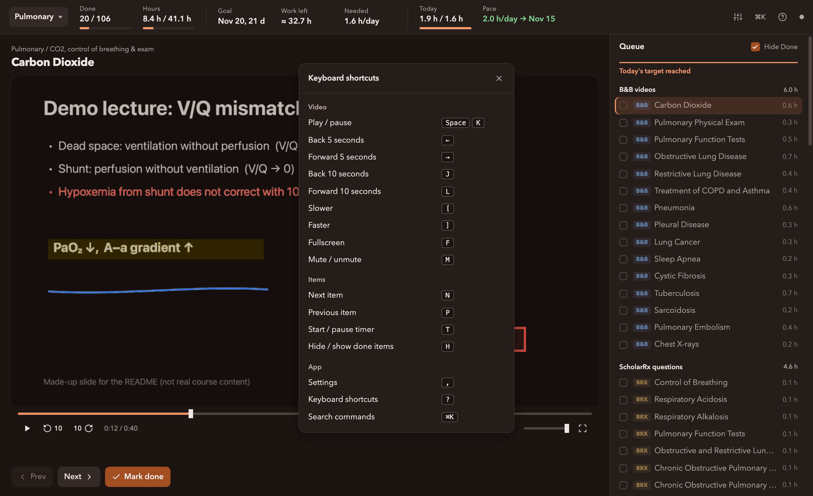</td></tr>
</table>

**Light mode too.** The interface follows your system theme. In light mode, videos play as they are.

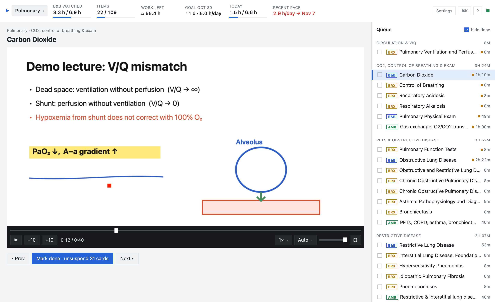

## Setup

1. Install [Anki](https://apps.ankiweb.net) with the [AnkiConnect](https://ankiweb.net/shared/info/2055492159) add-on and the AnKing Step 1 deck. VidAnki uses the deck's `#AK_Step1_v12::#B&B`, `#SketchyMicro`, `#SketchyPharm` and `#Low/HighYield` tags.
2. Set AnkiConnect's `webBindPort` to `8766` (Anki → Tools → Add-ons → AnkiConnect → Config), or put whatever port you use in `local.json`.
3. Link the bridge add-on into Anki so VidAnki can build filtered decks, then restart Anki:
   ```bash
   ln -s "$PWD/anki_addon/vidanki_bridge" ~/Library/Application\ Support/Anki2/addons21/vidanki_bridge
   ```
4. Copy `local.example.json` to `local.json` and point `bases` at your video folders. Blocks refer to them as `{bnb}` and `{sketchy}`. Set `ankiProfileDir` if your Anki profile isn't "User 1".
5. Optional: build the menu bar app with `macapp/build.sh` (needs the Xcode command line tools).

Needs macOS, Python 3.10+ (standard library only) and `ffprobe` (`brew install ffmpeg`). Video files aren't included.

## Run

Open **VidAnki** from Applications, Spotlight or Launchpad. It starts the server, opens the VidAnki tab in Chrome (or switches to it if one is already open), and adds a ▶ icon to the menu bar. The menu has Open VidAnki, Open Anki, Restart Server, Show Server Log and Open at Login. Quitting VidAnki from that menu stops the server.

The first time, macOS asks whether VidAnki may control Google Chrome. Allow it so VidAnki can switch to the tab you already have open instead of opening a new one. After you change `macapp/VidAnki.swift`, rebuild the app with `macapp/build.sh`.

Without the app:

Double-click `start.command`, or:

```bash
python3 server.py
```

Then open http://localhost:8770. Keep Anki open: it's needed to unsuspend cards and to check your progress on them.

## What "Mark done" does (videos)

1. Renames the file to start with `_` (so it's skipped next time). **Mark not done** renames it back.
2. Unsuspends `(1-HighYield ∪ 2-RelativelyHighYield ∪ 3-HighYield-temporary) ∩ <the video's tags>`.
3. Puts that video's new cards into the filtered deck **VidAnki**, so your daily new-card limit doesn't apply.
4. Shows the Anki gate. The next video unlocks once none of those cards are still new. **Skip, next item anyway** always works.

If Anki is closed, steps 2 and 3 wait and run as soon as Anki is open.

The VidAnki deck also pulls in the reviews due today from your AnKing deck, so you can study everything from one deck. Reviews done there count as normal reviews. The deck is rebuilt each study day (after 4 am) and whenever you mark a video done; "Rebuild VidAnki deck" in ⌘K refreshes it on demand. Turn this off in Settings, or set `reviewDeck` in `local.json` if your deck has a different name.

## Keyboard

Press `?` in the app for the full list, or `⌘K` to search every command and jump to any item.

| Key | Action |
| --- | --- |
| space / k | play / pause |
| ← / → | back / forward 5 s |
| j / l | back / forward 10 s |
| [ / ] | slower / faster |
| f | fullscreen |
| m | mute |
| n / p | next / previous item |
| t | start / pause the brick or AMBOSS timer |

Picture mode defaults to **Auto**: Smart dark when macOS is in dark mode, the original video in light mode. Smart dark flips white to near-black and black ink to light, while keeping colors. Change it per source (B&B or Sketchy) from the control bar or the ⌘K palette.

Bricks link to their ScholarRx page; the links came from the course tracklist spreadsheet.

## Time estimates

The header shows B&B hours watched, total work left (video + Anki + bricks + AMBOSS), hours/day needed to hit the goal date, today's progress, and your recent pace with a projected finish date.

The estimates start from defaults and move toward your own times as you go:

- Video: active time while playing, plus up to 90 s per pause.
- Anki: review times from Anki's own log for the cards this tool unsuspended.
- Bricks and AMBOSS: the timer on their page.

Days roll over at 4 am, as in Anki. Open "How estimates are learned" in the queue to see the current numbers.

## Adding a block

Copy `blocks/pulm.json` to e.g. `blocks/renal.json` and edit it:

- `roots`: the B&B block folder and the Sketchy folder, e.g. `{bnb}/19.Renal` and `{sketchy}`.
- `clusters`: groups in B&B order. Each item is `video` (with `source`, `file` relative to its root, written **without** a leading `_`, and AnKing `tags`), `brick`, or `amboss` (`questions`).
- `tags` can use the short prefixes defined in `tagPrefixes` (`BNB:`, `SM:`, `SP:`). Change `BNB:` to the block's `#B&B::NN_Block::` tag.

Restart the server and pick the block from the dropdown at top left.

## Phone (later)

`python3 server.py --lan` listens on your network: open `http://<your-mac's-ip>:8770` on your phone. With Tailscale on both devices, it works away from home too. Videos stream from the Mac, so the Mac must be on.

## Files

- `server.py`: Python standard library only; no installs needed.
- `static/`: the web page. The dark-mode shader is `shader.js`.
- `blocks/*.json`: curricula.
- `data/state.json`: your progress and time logs.
- `data/cache.json`: video durations and card counts.
- `anki_addon/vidanki_bridge`: a small Anki add-on (symlinked into Anki's add-ons folder) that lets AnkiConnect create filtered decks.
- `local.json`: your folder locations and Anki settings (not committed).
